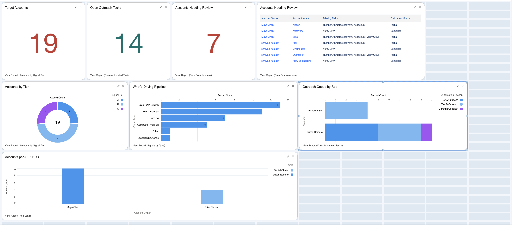
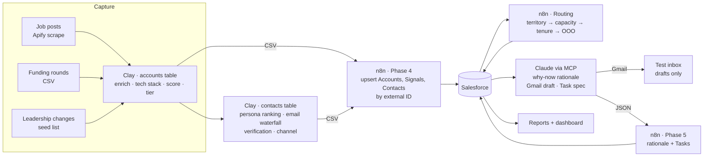
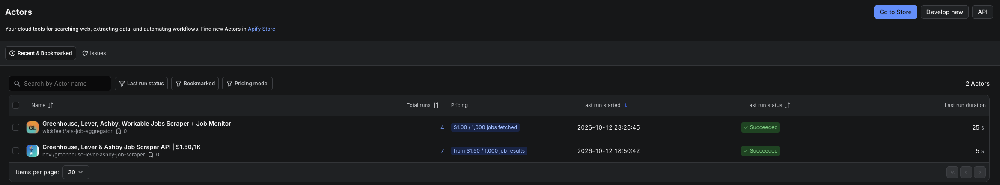
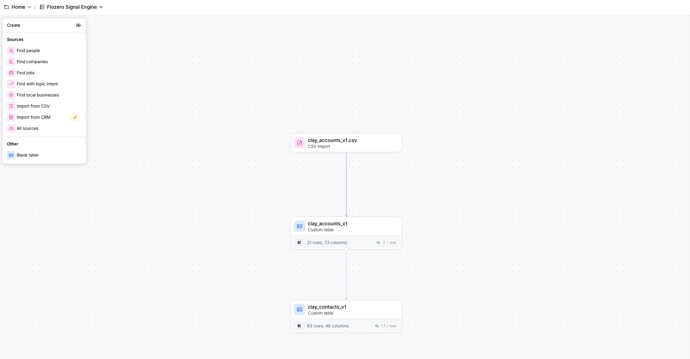
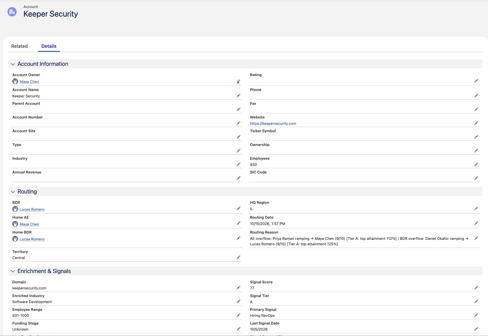
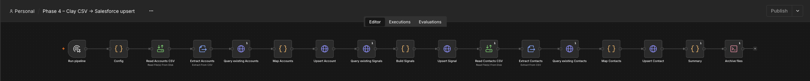
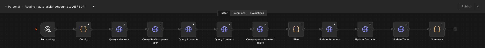
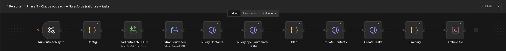

# Signal-to-Pipeline Engine

**Buying signals in, routed and worked pipeline out.** This project captures public buying signals,
enriches and scores accounts in Clay, and loads them into Salesforce through n8n with explicit
write-back rules. It then routes each account to the right AE and BDR by territory, capacity, tenure and
availability, and uses Claude via MCP to write a "why now" rationale, a test-inbox email draft and a
rep Task for every target contact.



| 19 | 38 | 14 | 14 | 7 |
|---|---|---|---|---|
| target accounts scored (A 5 · B 9 · C 5) | signals logged | Tier A/B accounts routed to 4 reps | outreach Tasks with rationale + draft | accounts flagged for review, never guessed |

**Fictional seller:** Flozero, a sales-compensation (ICM) platform. Tagline: *"Commissions on autopilot.
Zero spreadsheets, zero disputes."*
**ICP:** B2B companies with 20–300 quota-carrying reps, Series B–D, on Salesforce, in the US and Canada
([`docs/signal_taxonomy.md`](docs/signal_taxonomy.md)).

> Flozero and its sales team are fictional. The target accounts are real companies, and only company-level
> public data (domains, job-post URLs, funding news) is committed. Contact data lives only in Clay and a
> private Salesforce dev org, and all outreach goes to a test inbox.

---

## How it works



| Stage | What happens | Where |
|---|---|---|
| **1. Signals** | Six signal types with weights and decay: Hiring RevOps, Sales Team Growth, Funding, Leadership Change, Competitor Mention, Other | [`docs/signal_taxonomy.md`](docs/signal_taxonomy.md) |
| **2. Enrich + score** | Clay enriches firmographics and tech stack, scores 0–100 and assigns a tier (A ≥ 60 with at least one fresh signal, B 35–59, C, Excluded), then ranks contacts by persona and seniority and verifies emails | [`clay/`](clay/) |
| **3. Load** | n8n upserts by external ID (`Domain__c`, `Signal_Key__c`, `Email_Key__c`), so re-runs never duplicate. Fill-if-blank fields protect rep edits, and conflicting data is flagged instead of guessed | [`n8n/lib/mapping.js`](n8n/lib/mapping.js), [`docs/salesforce_schema.md`](docs/salesforce_schema.md) |
| **4. Route** | Each Tier A/B account gets an AE (Account owner) and a BDR, with the reason written on the record | [`n8n/lib/routing.js`](n8n/lib/routing.js) |
| **5. Outreach** | Claude writes a signal-grounded rationale, a ≤ 90-word email (or LinkedIn note) and a Task spec. n8n writes the rationale and Tasks to Salesforce, one open Task per contact | [`prompts/why_now_and_email.md`](prompts/why_now_and_email.md) |
| **6. Report** | Five reports and one dashboard prove each stage | [`docs/reporting.md`](docs/reporting.md) |

### Capture and enrichment

Job-post signals come from two Apify actors that scrape Greenhouse, Lever, Ashby and Workable boards,
for about $1 of a $5 free tier. Funding and leadership signals come from a CSV and a seed list.



In Clay, the **Flozero Signal Engine** workbook has two linked tables:
- `clay_accounts_v1` (21 rows, 73 columns) handles enrichment, tech stack, scoring and tiering.
- `clay_contacts_v1` (63 rows, 46 columns) handles persona ranking, primary-contact pick, the email waterfall and verification.

Accounts send rows to contacts with Clay's "send table data" step. Credits were rationed by tier,
for 40 used in total.

<p align="center"></p>

### Account routing

Every Tier A/B account is assigned to an AE and a BDR:

- **Territory first.** The territory comes from the account's HQ state or province, mapped to West, Central or East.
- **Overflow when needed.** If the territory rep is full or not eligible, Tier A goes to the highest quota attainment and Tier B goes to the rep with the most spare capacity.
- **Ramping reps** (first 90 days) carry half capacity and no Tier A accounts.
- **Out of office** means temporary coverage. The home rep is remembered and gets the account back automatically.
- **Inactive** means permanent reassignment.
- **Tier C** stays in the RevOps queue.

Ownership is sticky, so a re-run with no changes moves nothing. Contacts follow the AE, and open
automated Tasks follow the BDR. The rules are tested against six scenarios in
[`n8n/test_routing.js`](n8n/test_routing.js).



*Keeper Security is a Tier A account in Central territory. The Central AE is ramping, so it overflowed to the top-attainment AE and BDR, and the reason is written on the record.*

### n8n workflows

All three are generated from code (`n8n/build_*.py`) and import as JSON.





---

## Results

| Phase | Outcome |
|---|---|
| 2 · Capture | 21-account test set from job scrapes, a funding CSV and a leadership seed list |
| 3 · Clay | 2 linked tables. 14 primary contacts, 13 verified work emails, 1 LinkedIn-only, 40 credits used |
| 4 · Load | 19 Accounts, 38 Signals and 14 Contacts upserted, 0 errors. Idempotent re-runs: 0 created, all updated |
| 5 · Outreach | 14 rationales, 13 Gmail drafts to the test inbox, 1 LinkedIn note, 14 Tasks (Tier A due next day / High; Tier B due in 3 business days) |
| 5b · Claude in n8n | Same outreach step, now unattended: n8n calls the Claude API (Sonnet 5.5, JSON-schema output), validates every draft (length, greeting, sign-off, no links or emails, no numbers outside the signal data) and saves drafts on the Contact. No email node exists, so nothing can be sent. Live run: 12 of 14 drafts written, 2 held for review, about $0.16 |
| 5.5 · Routing | AEs: Maya 10, Priya 4 (ramping). BDRs: Lucas 10, Daniel 4 (ramping). Hannah's East accounts are on coverage while she is out of office |
| 6 · Reporting | 5 reports and a dashboard. 7 accounts flagged for review: 4 with a headcount conflict, 3 to verify CRM |

## Engineering choices worth noting

- **Every judgment call is logged.** [`docs/decisions.md`](docs/decisions.md) records 49 decisions, each with context, the decision, why, and the trade-off.
- **Flag, don't guess.** When Clay's headcount sources disagree, the field stays blank and the account gets "Verify headcount". The incumbent comp tool is filled only from a linkable public source ([`data/research/incumbent_comp_tool.csv`](data/research/incumbent_comp_tool.csv)).
- **Free-tier constraints made explicit.** Clay's API and webhooks are paid, so the hand-off is a CSV export. n8n reads it from a restricted inbox folder and moves processed files to `processed/<run>`, only when there are no errors.
- **Auth that matches the org.** The org's External Client App enforces PKCE, so n8n uses a generic OAuth2 + PKCE credential and calls the REST and composite APIs directly.
- **Claude for judgment, n8n for writes.** The model writes the wording, grounded only in signal data. Deterministic, logged code does every CRM write.
- **Tested logic.** `node n8n/test_mapping.js` covers the field mapping and `node n8n/test_routing.js <accounts.csv>` covers the six routing scenarios.

## Run it

```bash
bash scripts/start_n8n.sh                       # n8n on Node 22, file access limited to data/clay_exports
sf project deploy start --source-dir force-app --target-org signal-dev
bash scripts/seed_rep_capacity.sh               # rep status, OOO, start date, attainment, capacity
# 1. Export the Clay tables to data/clay_exports/inbox/ → run "Phase 4 – Clay CSV → Salesforce upsert"
# 2. Run "Routing – auto-assign Accounts to AE / BDR" (dryRun first)
# 3. Run "Phase 5b – Claude outreach in n8n" (useMock / dryRun first) — or the original MCP path ("Phase 5")
# 4. Re-run Routing so new Tasks land with the BDR
```

## Repo layout

```
docs/         decisions log, schema, signal taxonomy, reporting spec
clay/         scoring reference + Clay formula specs
n8n/          lib/ (mapping.js, routing.js), tests, workflow builders, workflows/*.json
prompts/      Claude outreach spec (rationale, email, LinkedIn note, Task)
force-app/    Salesforce metadata: custom fields, Signal__c, permission set
salesforce/   territories, fictional sales team, rep capacity roster, deploy notes
scripts/      n8n start, schema, sales team and rep-capacity setup
data/         research overrides (committed); clay_exports/ is git-ignored
screenshots/
```

## Backlog

- Unattended runs: schedule the chain (Phase 5b runs on the API, decision #50)
- Signal feedback loop: meeting rate by signal type → recalibrate weights
- Account brief + daily priority list (BDR); pre-meeting brief from calendar (AE)
- Reply triage and re-engagement dates; BDR → AE handoff summary
- Pain-post signals from public community threads (decision #32)
